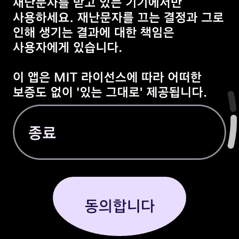
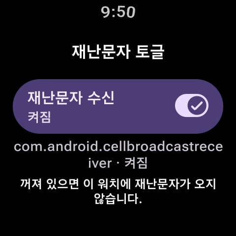
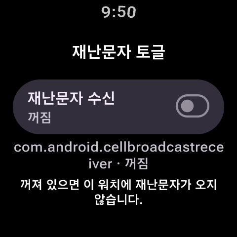

<p align="center">
  <a href="https://github.com/Kamilake/cell-broadcast-toggle/releases/latest/download/cell-broadcast-toggle.apk"></a>
</p>

# 재난문자 토글 (Cell Broadcast Toggle)


[Shizuku](https://shizuku.rikka.app/)를 이용해 Android 기기의 **재난문자(셀 방송, Wireless Emergency Alerts) 수신을 스위치 하나로 끄고 켜는** 앱입니다.
루팅이 필요 없습니다. 휴대전화용 앱과 Wear OS 워치용 앱이 있습니다.

진열용·개발용 기기처럼 **실제 경보를 다른 기기로 받고 있는** 휴대전화에서 불필요한 경보음을 없애기 위해 만들었습니다.

> [!WARNING]
> 끄면 지진·대피 경보를 포함한 **모든 재난문자가 그 기기에 오지 않습니다.**
> 평소 쓰는 휴대전화에서는 사용하지 마세요.

## 설치

위 버튼을 누르면 최신 버전 APK가 바로 내려받아집니다. 변경 사항과 이전 버전은 [Releases](https://github.com/Kamilake/cell-broadcast-toggle/releases)에 있습니다.

릴리스 APK는 아래 인증서로 서명됩니다. 다른 곳에서 받은 APK라면 지문을 비교해 보세요.

```
SHA-256: b0:4c:dc:8c:a4:36:17:8c:b0:c9:c8:8b:e4:ec:45:1d:5a:d9:a4:0b:16:58:01:eb:13:1c:c5:5a:58:f0:63:21
```

```powershell
apksigner verify --print-certs cell-broadcast-toggle.apk
```

## 첫 실행 동의

휴대전화와 워치 모두 처음 실행하면 면책 안내를 보여 줍니다. "동의합니다"를 누르기 전에는 Shizuku에 접근하지 않고, "종료"를 누르면 앱이 닫힙니다. 동의 여부는 기기마다 따로 저장되며, 앱 데이터를 지우면 다시 묻습니다.

## 스크린샷

| 꺼짐 | 켜짐 | Shizuku 권한 요청 |
|:---:|:---:|:---:|
|  |  |  |

## 동작 방식

앱은 Shizuku의 셸 권한으로 아래 패키지를 **사용자(프로필)별로** 비활성화하거나 다시 활성화합니다. 기기에 설치된 패키지만 바꿉니다.

| 패키지 | 역할 |
|---|---|
| `com.google.android.cellbroadcastreceiver` | 재난문자를 받아 알림으로 표시하는 앱 (휴대전화) |
| `com.google.android.cellbroadcastservice` | 셀 방송 메시지를 처리하는 서비스 모듈 (휴대전화) |
| `com.android.cellbroadcastreceiver` | AOSP 재난문자 앱 (Galaxy Watch 등 Wear OS) |

내부적으로 실행하는 명령은 adb에서 직접 입력하는 것과 같습니다.

```powershell
# 끄기
adb shell pm disable-user --user 0 com.google.android.cellbroadcastreceiver
adb shell pm disable-user --user 0 com.google.android.cellbroadcastservice

# 다시 켜기
adb shell pm enable --user 0 com.google.android.cellbroadcastreceiver
adb shell pm enable --user 0 com.google.android.cellbroadcastservice
```

- 기기에 있는 사용자(기본, 듀얼 앱, 업무 프로필 등)를 모두 찾아서, 설치된 패키지에만 적용합니다.
- 비활성화 상태는 재부팅 후에도 유지됩니다. Shizuku는 스위치를 바꿀 때만 필요합니다.
- 패키지를 삭제하지 않으므로 언제든 같은 스위치로 되돌릴 수 있습니다.
- 설정 오버레이(`com.google.android.overlay.modules.*`)는 건드리지 않습니다.

## 요구 사항

- 휴대전화: Android 12 이상 (Material You 동적 색상 사용)
- 워치: Wear OS 3(API 30) 이상
- [Shizuku](https://shizuku.rikka.app/) 설치 및 실행
  - 무선 디버깅으로 시작하면 컴퓨터 없이도 됩니다. Shizuku가 설치되지 않았거나 꺼져 있으면 앱이 단계별로 안내합니다.

## Shizuku 안내 화면

Shizuku가 없거나 꺼져 있으면 앱이 상황에 맞는 안내를 보여 줍니다. 다른 앱에서 작업을 마치고 돌아오면 자동으로 다시 확인합니다.

| Shizuku 꺼짐 (1/3) | Shizuku 꺼짐 (2/3) | Shizuku 꺼짐 (3/3) |
|:---:|:---:|:---:|
|  |  |  |

| Shizuku 미설치 |
|:---:|
|  |

- **꺼짐**: 보안 위험 자동 차단(갤럭시) → 개발자 옵션 → 무선 디버깅 → 페어링 → 시작 순서로 안내합니다. 개발자 옵션과 무선 디버깅이 이미 켜져 있으면 "완료"로 표시합니다.
  - 갤럭시의 **보안 위험 자동 차단**이 켜져 있으면 무선 디버깅이 막혀 Shizuku를 시작할 수 없고, 나중에 켜면 실행 중이던 Shizuku도 멈춥니다. 최신 갤럭시는 처음부터 켜져 있을 수 있어, 갤럭시에서는 이 단계가 맨 앞에 나오고 설정 화면으로 바로 가는 버튼을 제공합니다.
- **미설치**: Play 스토어와 GitHub 공식 배포 페이지로 바로 이동하는 버튼을 제공합니다.
- **권한 거부**: Shizuku 앱의 '인증된 앱'에서 다시 허용하도록 안내합니다.

검증한 기기: Galaxy Z Fold Special Edition (SM-F958N), Android 15

## Wear OS 워치

| 첫 실행 동의 | 켜짐 | 꺼짐 |
|:---:|:---:|:---:|
|  |  |  |

워치 앱은 휴대전화 앱과 같은 방식으로 동작하지만, 워치 화면에 맞게 스위치 하나만 보여 줍니다. 워치에서는 Shizuku 설치와 시작을 컴퓨터의 adb로 하는 것을 기준으로 안내합니다.

1. 워치에서 설정 → 개발자 옵션 → 무선 디버깅을 켜고, "새 기기 페어링"에 나오는 주소와 코드로 컴퓨터에서 페어링·연결합니다.

   ```powershell
   adb pair <IP>:<페어링 포트>
   adb connect <IP>:<연결 포트>
   ```

2. [Shizuku GitHub 릴리스](https://github.com/RikkaApps/Shizuku/releases)에서 APK를 받아 워치에 설치하고, Shizuku를 시작합니다. 시작 명령은 워치를 재부팅할 때마다 다시 실행해야 합니다.

   ```powershell
   adb install shizuku-*.apk
   adb shell 'p=$(pm path moe.shizuku.privileged.api) && a=${p#package:} && $(dirname $a)/lib/*/libshizuku.so'
   ```

3. 워치 앱을 설치하고 실행한 뒤 면책 안내에 동의합니다.
4. Shizuku 권한을 허용합니다. 둥근 화면에서는 Shizuku의 권한 요청 창이 잘려 허용 버튼이 보이지 않을 수 있습니다. 그럴 때는 Shizuku 앱 첫 화면의 인증된 앱 항목("어플리케이션 관리")에서 재난문자 토글의 스위치를 켜고 앱으로 돌아오세요.

검증한 기기: Galaxy Watch Ultra LTE (SM-L705N), Android 16 (API 36), Shizuku v13.6.0

## 알려진 제한

- **보안 폴더**처럼 셸 권한으로 접근할 수 없는 프로필은 바꿀 수 없습니다. 앱에 "접근할 수 없음"으로 표시됩니다.
- 패키지 이름은 Google 셀 방송 모듈과 AOSP 재난문자 앱 기준입니다. 제조사가 다른 패키지를 쓰는 기기에서는 "패키지를 찾지 못했습니다"로 표시됩니다.
- 워치 앱은 휴대전화 앱과 같은 패키지 이름(`com.kamilake.cbtoggle`)을 씁니다. 서로 다른 기기에 설치하므로 충돌하지 않지만, 두 APK 모두 필요하면 파일 이름으로 구분하세요.
- 시스템 업데이트 뒤에는 상태가 유지됐는지 앱에서 한 번 확인하는 것을 권장합니다.

## 빌드

JDK 21과 Android SDK(compileSdk 36.1)가 필요합니다. 프로젝트는 세 모듈로 나뉩니다.

| 모듈 | 내용 |
|---|---|
| `:core` | AIDL, Shizuku 서비스, 뷰 모델, 첫 실행 동의 문구, 앱 아이콘 |
| `:app` | 휴대전화 앱 (Material 3, Android 12 이상) |
| `:wear` | Wear OS 앱 (Wear Compose Material 3, Wear OS 3 이상) |

```powershell
./gradlew assembleDebug

# 휴대전화
adb install --user 0 app/build/outputs/apk/debug/app-debug.apk

# 워치
adb -s <워치 IP:포트> install wear/build/outputs/apk/debug/wear-debug.apk
```

`--user 0`을 빼면 듀얼 앱·업무 프로필 등 모든 사용자에게 설치됩니다.

서명된 릴리스 APK를 만들려면 저장소 최상위에 `keystore.properties`를 두고 `./gradlew assembleRelease`를 실행하세요. 이 파일은 git에서 제외됩니다.

```properties
storeFile=C:/path/to/release.jks
storePassword=...
keyAlias=...
keyPassword=...
```

파일이 없으면 서명되지 않은 릴리스 APK가 만들어집니다.

## 라이선스

[MIT](LICENSE)

앱 아이콘은 Android Open Source Project의 CellBroadcastReceiver 아이콘(Apache License 2.0)을 사용했습니다. 자세한 내용은 [NOTICE](NOTICE)를 참고하세요.
