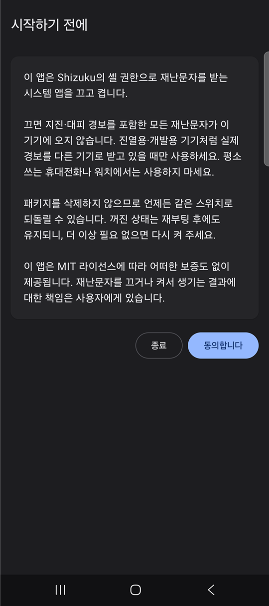
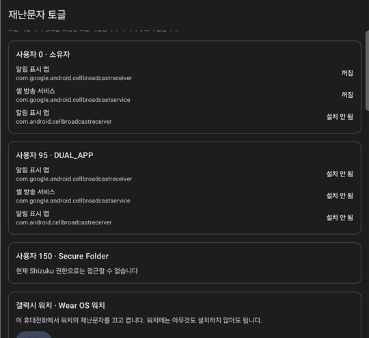
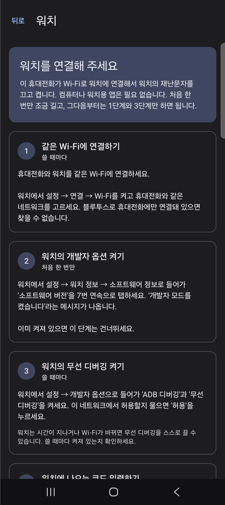
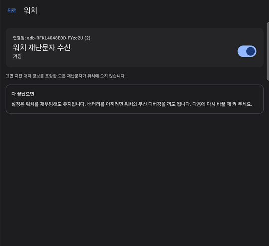

<p align="center">
  <a href="https://github.com/Kuco-dev/cell-broadcast-toggle-next/releases/latest/download/cell-broadcast-toggle.apk"></a>
</p>

# 재난문자 토글 (Cell Broadcast Toggle)


[Shizuku](https://shizuku.rikka.app/)를 이용해 Android 기기의 **재난문자(셀 방송, Wireless Emergency Alerts) 수신을 스위치 하나로 끄고 켜는** 앱입니다.
루팅이 필요 없습니다. 갤럭시 워치 등 Wear OS 워치의 재난문자도 휴대전화에서 끄고 켤 수 있습니다. 워치에는 아무것도 설치하지 않아도 됩니다.

진열용·개발용 기기처럼 **실제 경보를 다른 기기로 받고 있는** 휴대전화에서 불필요한 경보음을 없애기 위해 만들었습니다.

> [!WARNING]
> 끄면 지진·대피 경보를 포함한 **모든 재난문자가 그 기기에 오지 않습니다.**
> 평소 쓰는 휴대전화에서는 사용하지 마세요.

## 사용 목적

이 프로젝트는 Android 휴대전화와 Wear OS 워치의 재난문자 수신 기능을 사용자가 직접 관리하기 위한 오픈소스 프로젝트입니다. **시험 부정행위나 다른 사람의 법령·규정 위반을 돕기 위해 만든 것이 아닙니다.** 시험장처럼 전자기기 사용이 제한된 곳에서 규정을 피하는 용도로 사용하지 마세요.

이 기능을 켜면 실제 재난 상황에서도 경보를 받지 못할 수 있습니다. 이 위험을 충분히 이해한 상태에서만 사용하세요.

## 설치

위 버튼을 누르면 최신 버전 APK가 바로 내려받아집니다. 변경 사항과 이전 버전은 [Releases](https://github.com/Kuco-dev/cell-broadcast-toggle-next/releases)에 있습니다.

릴리스 APK는 아래 인증서로 서명됩니다. 다른 곳에서 받은 APK라면 지문을 비교해 보세요.

```
SHA-256: ee:dc:0a:04:7c:6f:6b:2b:d3:18:6f:36:1f:32:68:0c:3d:7a:8a:07:4d:2c:81:93:7e:f0:4b:67:c7:eb:3c:3f
```

[원본 저장소](https://github.com/Kamilake/cell-broadcast-toggle)의 앱과 서명이 다르므로, 원본 앱이 설치돼 있으면 먼저 삭제한 뒤 설치하세요. 삭제하기 전에 재난문자를 다시 켜 두는 것을 권장합니다.

```powershell
apksigner verify --print-certs cell-broadcast-toggle.apk
```

## 스크린샷

| 꺼짐 | 켜짐 | Shizuku 권한 요청 |
|:---:|:---:|:---:|
|  |  |  |

## 첫 실행 동의



처음 실행하면 면책 안내를 보여 줍니다. "동의합니다"를 누르기 전에는 Shizuku에 접근하지 않고, "종료"를 누르면 앱이 닫힙니다. 앱 데이터를 지우면 다시 묻습니다.

## 동작 방식

앱은 Shizuku의 셸 권한으로 아래 패키지를 **사용자(프로필)별로** 비활성화하거나 다시 활성화합니다. 기기에 설치된 패키지만 바꿉니다.

| 패키지 | 역할 |
|---|---|
| `com.google.android.cellbroadcastreceiver` | 재난문자를 받아 알림으로 표시하는 앱 (휴대전화) |
| `com.google.android.cellbroadcastservice` | 셀 방송 메시지를 처리하는 서비스 모듈 (휴대전화) |
| `com.android.cellbroadcastreceiver` | AOSP 재난문자 앱 (갤럭시 워치 등 Wear OS) |

내부적으로 실행하는 명령은 adb에서 직접 입력하는 것과 같습니다.

```powershell
# 끄기
adb shell pm disable-user --user 0 com.google.android.cellbroadcastreceiver
adb shell pm disable-user --user 0 com.google.android.cellbroadcastservice

# 다시 켜기
adb shell pm enable --user 0 com.google.android.cellbroadcastreceiver
adb shell pm enable --user 0 com.google.android.cellbroadcastservice
```

- 기기에 있는 사용자(기본, 듀얼 앱, 업무 프로필 등)를 모두 찾아서, 설치된 패키지에만 적용합니다.
- 비활성화 상태는 재부팅 후에도 유지됩니다. Shizuku는 스위치를 바꿀 때만 필요합니다.
- 패키지를 삭제하지 않으므로 언제든 같은 스위치로 되돌릴 수 있습니다.
- 설정 오버레이(`com.google.android.overlay.modules.*`)는 건드리지 않습니다.

## 요구 사항

- Android 12 이상 휴대전화 (Material You 동적 색상 사용)
- [Shizuku](https://shizuku.rikka.app/) 설치 및 실행
  - 무선 디버깅으로 시작하면 컴퓨터 없이도 됩니다. Shizuku가 설치되지 않았거나 꺼져 있으면 앱이 단계별로 안내합니다.
- 워치를 끄고 켜려면: 무선 디버깅이 있는 Wear OS 워치(갤럭시 워치 등)와, 휴대전화와 워치가 함께 연결할 Wi‑Fi

## Shizuku 안내 화면

Shizuku가 없거나 꺼져 있으면 앱이 상황에 맞는 안내를 보여 줍니다. 다른 앱에서 작업을 마치고 돌아오면 자동으로 다시 확인합니다.

| Shizuku 꺼짐 (1/3) | Shizuku 꺼짐 (2/3) | Shizuku 꺼짐 (3/3) |
|:---:|:---:|:---:|
|  |  |  |

| Shizuku 미설치 |
|:---:|
|  |

- **꺼짐**: 보안 위험 자동 차단(갤럭시) → 개발자 옵션 → 무선 디버깅 → 페어링 → 시작 순서로 안내합니다. 개발자 옵션과 무선 디버깅이 이미 켜져 있으면 "완료"로 표시합니다.
  - 갤럭시의 **보안 위험 자동 차단**이 켜져 있으면 무선 디버깅이 막혀 Shizuku를 시작할 수 없고, 나중에 켜면 실행 중이던 Shizuku도 멈춥니다. 최신 갤럭시는 처음부터 켜져 있을 수 있어, 갤럭시에서는 이 단계가 맨 앞에 나오고 설정 화면으로 바로 가는 버튼을 제공합니다.
- **미설치**: Play 스토어와 GitHub 공식 배포 페이지로 바로 이동하는 버튼을 제공합니다.
- **권한 거부**: Shizuku 앱의 '인증된 앱'에서 다시 허용하도록 안내합니다.

검증한 기기: Galaxy Z Fold Special Edition (SM-F958N), Android 15

## 갤럭시 워치 · Wear OS 워치

| 워치 카드 | 연결 안내 | 워치 재난문자 스위치 |
|:---:|:---:|:---:|
|  |  |  |

휴대전화 앱이 같은 Wi‑Fi에 있는 워치의 무선 디버깅에 연결해서 워치의 재난문자를 끄고 켭니다. 컴퓨터나 워치용 앱, 워치의 Shizuku는 필요 없습니다.

Shizuku 권한을 받아 휴대전화의 재난문자 스위치가 보이면, 첫 화면 맨 아래에 "갤럭시 워치 · Wear OS 워치" 카드가 나타납니다. 카드의 "워치" 버튼을 누르고 앱의 안내를 따라가세요.

1. **같은 Wi‑Fi에 연결하기** (쓸 때마다): 휴대전화와 워치를 같은 Wi‑Fi에 연결합니다. 워치가 블루투스로 휴대전화에만 연결돼 있으면 찾을 수 없습니다.
2. **워치의 개발자 옵션 켜기** (처음 한 번만): 워치에서 설정 → 워치 정보 → 소프트웨어 정보의 "소프트웨어 버전"을 7번 탭합니다.
3. **워치의 무선 디버깅 켜기** (쓸 때마다): 워치에서 설정 → 개발자 옵션의 "ADB 디버깅"과 "무선 디버깅"을 켭니다.
4. **워치에 나오는 코드 입력하기** (처음 한 번만): 워치의 무선 디버깅 → "새 기기 페어링"에 나오는 6자리 코드를 휴대전화 앱에 입력합니다. IP와 포트는 앱이 스스로 찾습니다.

한 번 페어링하면 다음부터는 1단계와 3단계만 하면 됩니다. 꺼진 상태는 워치를 재부팅해도 유지되므로, 설정을 바꾼 뒤에는 워치의 무선 디버깅을 꺼도 됩니다. 갤럭시 워치에는 보안 위험 자동 차단이 없어서 이 단계는 휴대전화에서만 안내합니다.

내부적으로는 컴퓨터에서 `adb pair`와 `adb connect`로 워치에 연결하는 것과 같은 방식입니다. 휴대전화 앱이 워치에서 위 "동작 방식"의 명령을 실행합니다.

검증한 기기: Galaxy Z Fold7 (SM-F966N, Android 17) + Galaxy Watch Ultra LTE (SM-L705N, Android 16)

## 알려진 제한

- **보안 폴더**처럼 셸 권한으로 접근할 수 없는 프로필은 바꿀 수 없습니다. 앱에 "접근할 수 없음"으로 표시됩니다.
- 패키지 이름은 Google 셀 방송 모듈과 AOSP 재난문자 앱 기준입니다. 제조사가 다른 패키지를 쓰는 기기에서는 "패키지를 찾지 못했습니다"로 표시됩니다.
- 워치 연결은 같은 Wi‑Fi에서만 됩니다. 워치가 자동으로 무선 디버깅을 끄면 다시 켜야 하고, Android는 한동안 쓰지 않은 페어링을 지울 수 있어 그때는 코드를 다시 입력해야 합니다.
- 시스템 업데이트 뒤에는 상태가 유지됐는지 앱에서 한 번 확인하는 것을 권장합니다.

## 빌드

JDK 21과 Android SDK(compileSdk 36.1)가 필요합니다. 프로젝트는 두 모듈로 나뉩니다.

| 모듈 | 내용 |
|---|---|
| `:core` | AIDL, Shizuku 서비스, 패키지 끄기·켜기 로직, 뷰 모델, 첫 실행 동의 문구, 앱 아이콘 |
| `:app` | 휴대전화 앱 (Material 3), 워치 연결 화면 |

```powershell
./gradlew assembleDebug
adb install --user 0 app/build/outputs/apk/debug/app-debug.apk
```

디버그 빌드는 패키지 이름이 `com.kamilake.cbtoggle.debug`라서 릴리스 앱과 함께 설치됩니다. `--user 0`을 빼면 듀얼 앱·업무 프로필 등 모든 사용자에게 설치됩니다.

워치 연결에는 [LibADB Android](https://github.com/MuntashirAkon/libadb-android)를 씁니다. 이 라이브러리와 SPAKE2 의존성은 JitPack에서 내려받습니다.

서명된 릴리스 APK를 만들려면 저장소 최상위에 `keystore.properties`를 두고 `./gradlew assembleRelease`를 실행하세요. 이 파일은 git에서 제외됩니다.

```properties
storeFile=C:/path/to/release.jks
storePassword=...
keyAlias=...
keyPassword=...
```

파일이 없으면 서명되지 않은 릴리스 APK가 만들어집니다.

## 라이선스

[MIT](LICENSE)

앱 아이콘은 Android Open Source Project의 CellBroadcastReceiver 아이콘(Apache License 2.0)을 사용했습니다. 워치 연결에는 LibADB Android(Apache License 2.0), Spake2-Java(LGPL-3.0), Conscrypt(Apache License 2.0), Bouncy Castle(MIT 계열)을 씁니다. 자세한 내용은 [NOTICE](NOTICE)를 참고하세요.
